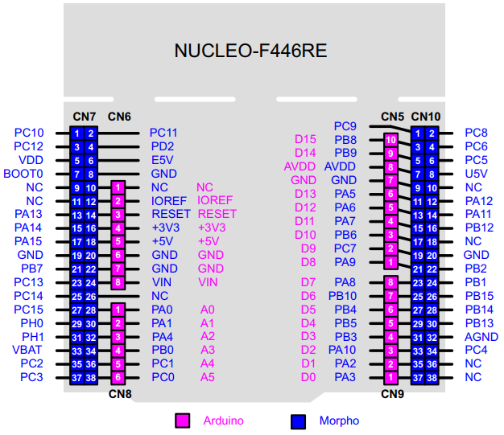

# STM32 RTOS Sensor Streaming

A NUCLEO-F446RE samples an analog input and sends timestamped ADC readings to a Python host. The host displays readings and sends start, stop, sample-period, and status commands.

UART command reception is interrupt-driven. Received bytes pass through a bounded RTOS queue to the command task, which sleeps while waiting for data and performs parsing outside the interrupt.

## Requirements and wiring

- **Board:** STM32 NUCLEO-F446RE.
- **RTOS:** FreeRTOS through CMSIS-RTOS2.
- **Tools:** STM32CubeIDE 2.2.0, Python 3.10 or newer, and Git.
- Connect the board's ST-LINK USB Mini-B connector to the PC using a USB data cable.
- Connect the analog sensor output to **PA4 / ADC1_IN4**, with a common ground and a signal within the board's supported ADC input range. Readings are raw 12-bit ADC counts.
- On Windows, install the ST-LINK USB driver if the virtual COM port is missing.



## Build and run the firmware

1. Clone this repository and open STM32CubeIDE with a fresh workspace.
2. Select **File → Import → General → Existing Projects into Workspace** and import `RTOS_TakeHome_Jose` from the cloned repository.
3. Select the imported project and choose **Project → Build Project**. The default configuration produces `Debug/RTOS_TakeHome_Jose.elf`.
4. Connect the board's ST-LINK USB connector to the PC.
5. With the project selected, use **Run** to flash and start the application. If prompted, select **STM32 Cortex-M C/C++ Application** and ST-LINK. 

Sampling starts automatically at a 100 ms period. Keep the board powered and running while using the host tool. Generated build files are recreated by the IDE. 

## Run the Python host

The Python files are in `host/`. From the repository root, run these commands in Windows PowerShell:

```powershell
cd host
python -m venv .venv
.\.venv\Scripts\python.exe -m pip install -r requirements.txt
.\.venv\Scripts\python.exe receiver.py --list-ports
.\.venv\Scripts\python.exe receiver.py --port COM5
```

Replace **COM5** with the port listed for your board. Close any other application using that port. `requirements.txt` installs `pyserial==3.5`.

To automatically select a single recognizable ST-LINK port:

```powershell
.\.venv\Scripts\python.exe receiver.py
```

With multiple boards, select a port explicitly or use `--serial-number YOUR_USB_SERIAL`, using the value from `--list-ports`.

The link uses **115200 baud, 8N1, no flow control**. At the receiver's `Command>` prompt, enter:

| Command | Effect |
| --- | --- |
| `start` | Resume sampling |
| `stop` | Stop sampling |
| `rate x` | Set the sample period to x ms |
| `status` | Report sampling state and period |
| `quit` | Exit the host tool |

Commands are case-insensitive. Firmware and host accept integer periods of **10–1,000 ms**. Timestamps are elapsed milliseconds since boot and reset on reboot. Closing the host leaves the powered MCU running; reopen the receiver to resume reception. Missed readings are not replayed. 

## Run the tests

From `host/`:

```powershell
.\.venv\Scripts\python.exe -m unittest -v test_protocol
```

Expected result: **12 tests, OK**, including 1,000 repeatable fuzz cases. No board connection is needed. Tests check host-parser recovery from corruption, truncation, and attaching mid-frame; they do not test MCU interrupt timing.

For clean-clone verification, follow the steps above from a fresh clone, then check `stop`, `status`, `start`, and `rate x`. Close and reopen the receiver while the board stays powered and confirm readings and commands resume.
